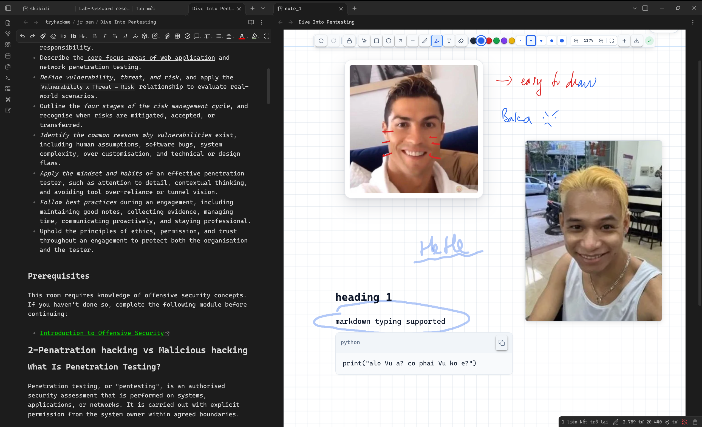

# My Note (Obsidian Plugin)

A digital paper notebook for Obsidian that brings handwriting, markdown notes, sketches, and images together on structured physical pages.



## Installation

Installing the plugin is simple and only requires copying three files:

1. Open your Obsidian vault folder on your computer.
2. Go to the `.obsidian/plugins/` directory.  
   *(If you don't see `.obsidian`, enable "Show hidden files" in your system file manager).*
3. Create a new folder named `mynote`.
4. Copy these 3 files into that `mynote` folder:
   - `main.js`
   - `manifest.json`
   - `styles.css`
5. Open Obsidian, go to **Settings → Community plugins**, click the reload icon next to **Installed plugins**, and turn on **My Note**.

That's it! The plugin is ready to use.

---

## Features

- **Natural handwriting**: Smooth pen and highlighter with pressure sensitivity and fine stroke widths (1.0px, 1.4px, 2.8px, 6.0px, and 10.0px).
- **Markdown text boxes**: Double-click anywhere to add a text note. Supports checklists, math formulas (KaTeX), code blocks, and internal links.
- **Image pasting**: Press `Ctrl + V` (or `Cmd + V`) to paste images directly where your cursor is placed.
- **Shapes**: Draw hand-drawn rectangles, circles, arrows, and lines with adjustable colors and roughness.
- **Unified selection**: Drag a selection box to select drawings, text, and images together. Move them as a group, duplicate (`Ctrl + D`), or delete.
- **Smooth scrolling & zoom**: Natural scrolling that reaches boundaries accurately at any zoom level.
- **PDF Export**: Export your entire multi-page notebook to PDF with one click.
- **Seamless integration**: Opens instantly without tab-bar flickering or reloading.

---

## Getting Started

### Creating and Opening Notes

- **Create a notebook**: Click the notebook ribbon icon on the left or open the Command Palette (`Ctrl + P` / `Cmd + P`) and choose **MyBook: Create new notebook**.
- **Open an existing notebook**: Click any `.mynote.md` file in your file explorer.
- **Switch an open note to notebook view**: Run **MyBook: Open current file in MyBook** from the Command Palette.

### Keyboard Shortcuts

| Shortcut | Action |
| --- | --- |
| `1` – `9` | Switch active tool (Select, Pen, Highlighter, Eraser, Shapes, Text) |
| `Ctrl + Z` / `Ctrl + Y` | Undo / Redo |
| `Ctrl + D` | Duplicate selected elements |
| `Delete` / `Backspace` | Remove selected elements |
| `Arrow keys` / `PageUp` / `PageDown` | Smooth vertical & horizontal scrolling |
| `Home` / `End` | Jump to the very top / bottom of the notebook |
| `Double Click` | Add a new markdown text box |
| `Esc` | Clear current selection |

### Exporting to PDF

Click the download icon in the top toolbar to export your notebook. The generated PDF will be saved directly alongside your note file in your vault.

---

## Building from Source

If you prefer building the plugin from source:

```bash
npm install
npm run build
```

The output files (`main.js`, `manifest.json`, and `styles.css`) will be updated in this directory.

---

## License

MIT License. Free to use, adapt, and share.
